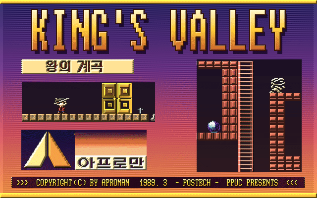
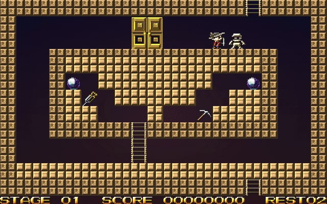

# 왕의 계곡 (KING'S VALLEY)

1989년 아프로만(APROMAN, POSTECH PPUC)이 터보 파스칼로 만든 도스 게임 `B.EXE` 를
역어셈블해서 C 로 옮기고, 화면과 소리를 새로 꾸민 256색 판을 더한 것입니다.




실행 파일은 둘입니다.

| | 설명 |
|---|---|
| **KV.EXE** | 원판 그대로. 게임 규칙, 스테이지, 소리, 속도가 1989년 판과 같습니다. 원판이 CGA 640x200 흑백으로 그리던 화면을 VGA 640x480 가운데에 한 줄을 두 줄로 늘려 보여 줍니다. |
| **KVVGA.EXE** | 개선판. 같은 소스를 `-DKVVGA` 로 따로 컴파일하고 화면과 소리만 바꿨습니다. 게임 규칙과 속도는 KV.EXE 와 같습니다. |

## KVVGA.EXE 에서 달라진 것

- VESA 256색 640x400 화면 (없으면 640x480 가운데, 그것도 없으면 320x200)
- 원판 흑백 그림의 윤곽은 그대로 두고 색과 입체감만 입혔습니다
  (탐험가, 미라, 황금 관, 문, 도구, 영혼석 ...)
- 벽 무늬 7가지를 서로 다른 돌로 (사암, 청금석, 비취, 붉은 화강암, 자수정, 금, 흑요석)
- 타이틀 그림도 원판 그대로 칠하고, 제목만 금 블록 글자로 새로 그렸습니다
- 애드립(OPL2) 배경음악 - 새로 지은 이집트풍 곡 여섯 개
  (타이틀, 게임 중, 타악기만, 스테이지 깸, 죽음, 게임 끝). 효과음은 원판대로 PC 스피커
- 게임 중 `Esc` 로 바로 도스로
- 방향키를 겹쳐 누르다 앞 키를 떼도 멈칫하지 않고 바로 돌아섭니다

## 게임

피라미드 속 방들을 돌아다니며 영혼석(SOUL STONE)을 모두 모으면 출구 문이 열립니다.
미라에게 잡히면 목숨을 하나 잃습니다. 떨어져 있는 도구는 한 번에 하나만 들 수 있습니다.

| 키 | |
|---|---|
| 왼쪽 / 오른쪽 | 걷기 |
| 위 / 아래 | 사다리 오르내리기 |
| Space | 뛰기, 또는 든 도구 쓰기 (단검 던지기, 곡괭이·삽·드릴로 벽돌 파기) |
| F1 / F2 | 잠깐 멈춤 / 방 지도 |
| F3 | 배경음악 ↔ 박자 |
| F4 / F10 | 스스로 목숨 버리기 (갇혔을 때) / 게임 끝 |
| Esc | 바로 도스로 (KVVGA.EXE 만) |

첫 메뉴에서 `1` 게임 시작, `2` 스테이지 편집, `3` 스테이지 골라 시작, `4` 끝내기입니다.
스테이지는 60개이고 10 스테이지마다 벽 무늬가 바뀝니다.

스테이지 편집기는 화살표로 커서를 옮기고 `F1` 타일 놓기, `F3`/`F4` 다음·이전 타일,
`Space` 지우기, `F9` 방 전체 지우기, `a`..`i` 로 방 바꾸기(한 스테이지는 3x3 방),
`ESC` 로 `KINGS-V.DAT` 에 저장하고 끝냅니다.

## 실행

DOSBox 나 도스에서 그 폴더로 가서 `KV` 또는 `KVVGA` 라고 칩니다.
빌드한 뒤 아래 파일만 한 폴더에 모으면 됩니다 (`release\` 폴더는 빌드 결과라 저장소에 넣지 않습니다).

- 공통: `CWSDPMI.EXE`(도스에서 32비트로 돌리기 위한 DPMI 서버), `KINGS-V.IFM`(타이틀 그림),
  `KINGS-V.DAT`(스테이지)
- KVVGA 에 더 필요한 것: `KV256.SPR`(256색 그림), `SOUND.DAT`(애드립 곡)
- 음악을 들으려면 애드립이나 사운드 블라스터(포트 388h)가 있어야 합니다 (DOSBox 는 기본 설정 그대로)

## 빌드

djgpp(i586-pc-msdosdjgpp, gcc 4.9) 로 컴파일합니다. djgpp 환경을 연 창에서

```
make -f kv.mak             둘 다
make -f kv.mak orig        KV.EXE
make -f kv.mak vga         KVVGA.EXE
make -f kv.mak test        KVTEST.EXE, KVTESTV.EXE (자동 시험판)
make -f kv.mak clean
```

## 소스

| 파일 | |
|---|---|
| `kv.h` | 공용 선언, 원본 주소 대조표 |
| `main.c` | 메인, 전역 변수, 한 판 돌리기, 키 처리 |
| `title.c` | 타이틀, 제작진, 첫 메뉴 |
| `player.c` | 걷기, 사다리, 다리, 점프, 죽음 |
| `gamelib.c` | 점수판, 방 이동, 단검, 줍기, 출구 |
| `mummy.c` | 미라 |
| `editor.c` | 스테이지 편집기 |
| `system.c` | 터보 파스칼 Crt/Dos 흉내, 인터럽트 처리기, 자동 시험 |
| `data.c` | 원본 데이터 세그먼트에서 뽑은 악보, 스프라이트, PCM |
| `graph.c` | 흑백 화면 (KV.EXE) - 볼랜드 Graph 유닛 + CGA 드라이버 흉내 |
| `graph256.c` | 256색 화면 (KVVGA.EXE) - 그린 것의 목록을 들고 다시 합성 |
| `musvgm.c` | 애드립(OPL2) VGM 재생 (KVVGA.EXE) |
| `listing.asm` | 원본 역어셈블 목록 (이름을 붙인 것) |

원본 그림과 소리는 `graph256.c` 가 흑백 비트맵 "내용"으로 색 그림을 찾습니다.
원판이 실행 중에 벽 무늬를 바꾸고 AND 로 섞기 때문입니다.

## 도구 (`tools/`, 파이썬 + PIL)

| | |
|---|---|
| `unpklite.py` | PKLITE 로 압축된 `B.EXE` 를 풀어 `B_UNP.EXE` / `B_UNP.BIN` 으로 |
| `mklist.py`, `dis.py`, `ds.py`, `names.txt` | 역어셈블 목록과 이름 붙이기 |
| `mkdata.py` | 원본 데이터 세그먼트 -> `data.c` |
| `mkspr256.py` | 원판 흑백 그림을 칠해서 `KV256.SPR` (`--preview 폴더` 로 미리보기 PNG) |
| `mkmusic.py` | 애드립 곡을 지어 `SOUND.DAT` 로 묶기 |
| `pbm2png.py` | 시험판이 찍은 화면을 PNG 로 |

## 시험

`make -f kv.mak test` 로 만드는 `KVTEST.EXE` / `KVTESTV.EXE` 는 `KVTEST.TXT` 의 줄을
시각 순서대로 실행합니다 (키보드 없이 DOSBox 에서 돌려 볼 때).

```
<ms> down <스캔코드> <ASCII>    키 누름        예) 12000 down 02 31
<ms> up <스캔코드>              키 뗌
<ms> shot <이름>                화면을 <이름>.PBM (KVTESTV 는 .PPM) 으로
<ms> set player <x> <y>         플레이어를 옮긴다
<ms> set exit                   영혼석을 다 모은 것으로 하고 출구 앞으로
<ms> quit                       끝
```

`KVTESTV.EXE` 는 원판 흑백 화면(`graph.c` 를 `shadow_*` 이름으로 함께 컴파일한 것)도
나란히 그려 두고, 원판에서는 지워진 그림이 색 화면에 남으면 `KVCHECK.LOG` 에 적습니다.
256색 판의 잔상을 찾는 데 썼습니다.

## 원본

`B.EXE`, `KINGS-V.IFM`, `KINGS-V.DAT` 는 1989년 원본 파일입니다.
게임 제작진 화면에는 ART DESIGN AND MAIN PROGRAMMER OH JEON SEOK,
TECHNICAL ASSISTANT KIM HEA JIN, GAME DESIGNER KYEONG YEOL 로 적혀 있습니다.
이 저장소는 그 게임을 C 로 옮기고 화면과 소리를 새로 꾸민 것입니다.
